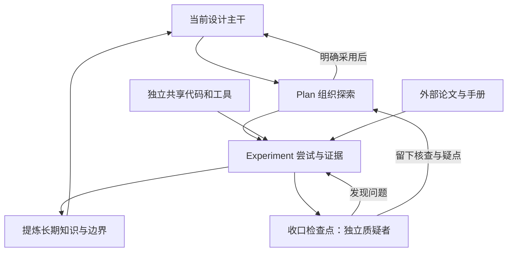
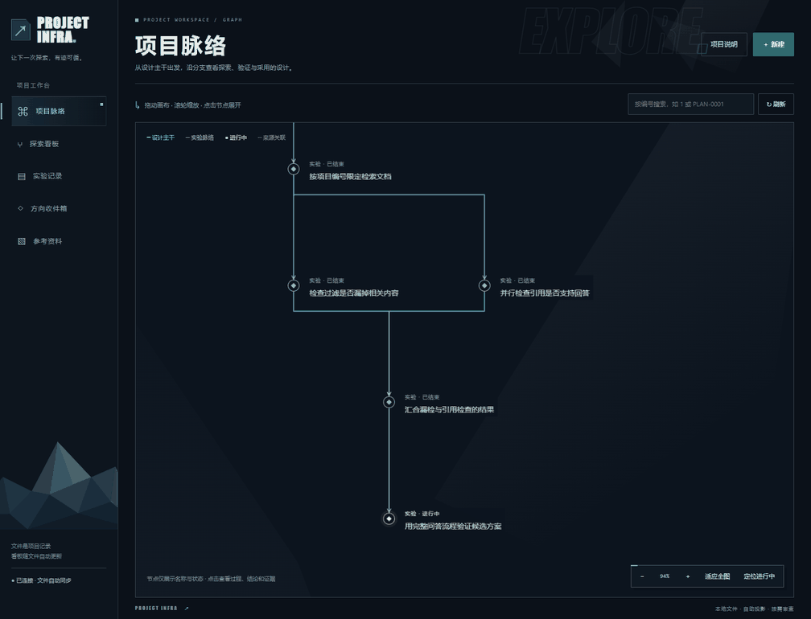
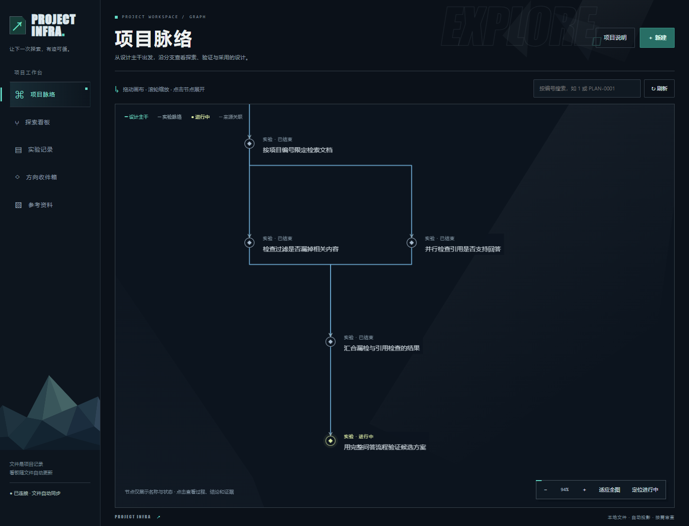
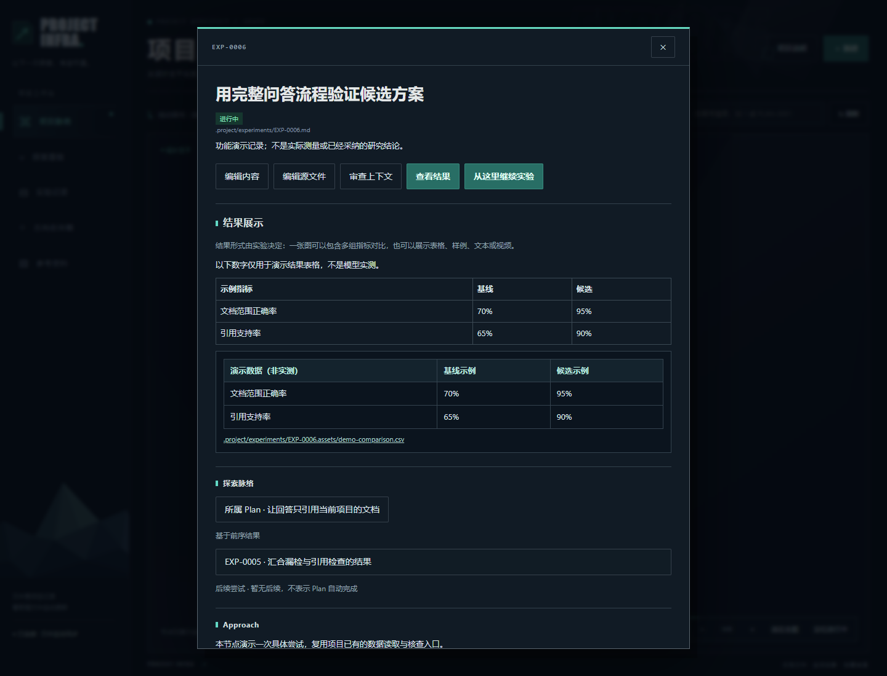
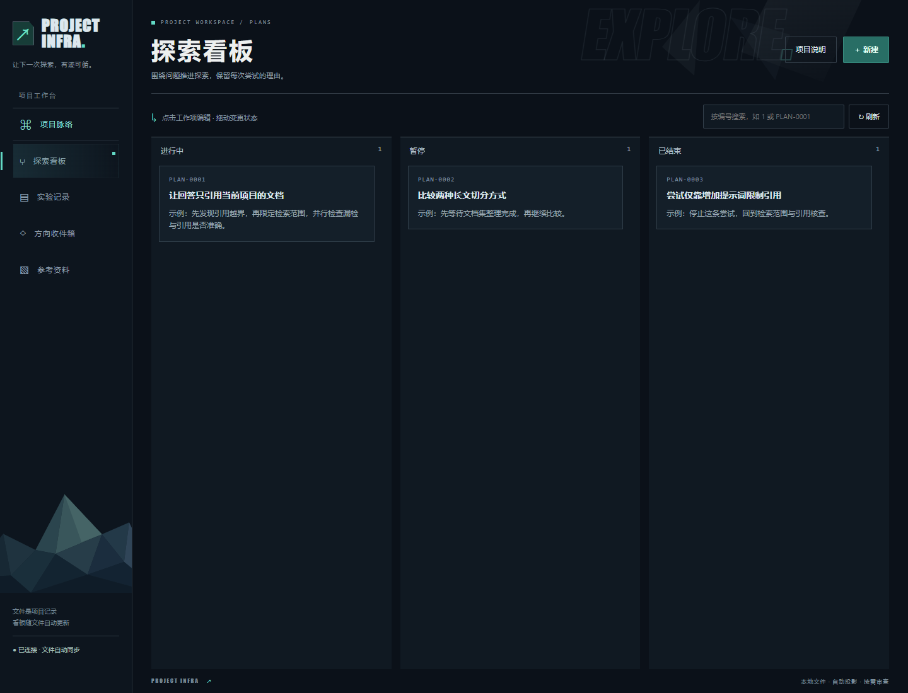
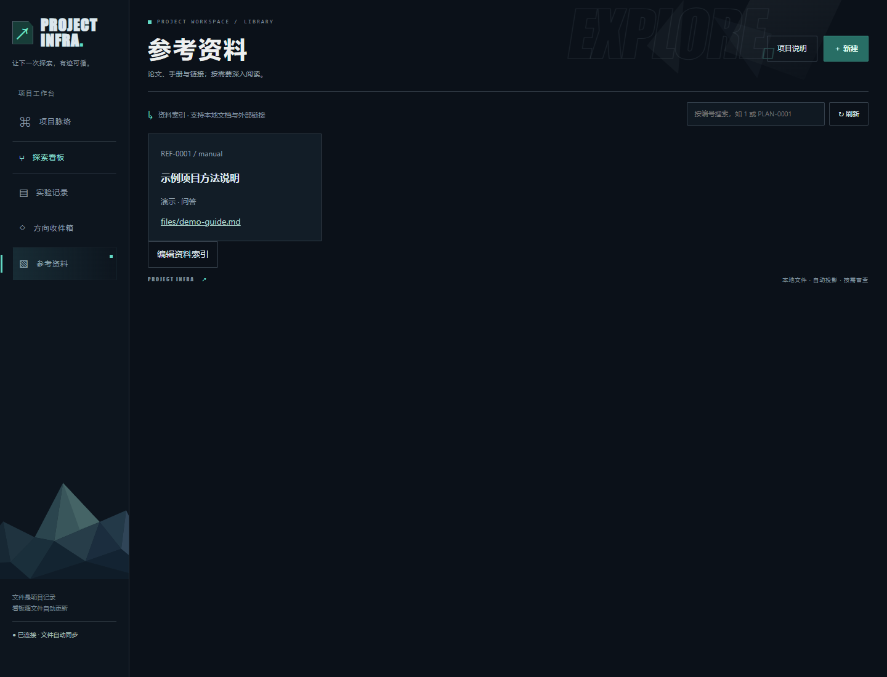

<p align="center"></p>

# Project Infra

**把设计主线、探索分支和实验依据留在项目里，让人与没有聊天背景的 Agent 都能接手工作。**

Project Infra 是一套面向探索型开发、研究项目和 Vibe Coding 的项目基础设施：让项目自己保存当前设计、探索依据、长期知识与共享实现，支持零背景 Agent 接手，以及低频独立质疑。Markdown / TOML 和源码文件是记录本体，可视化看板只是它们的可编辑投影。

[下载安装包](https://github.com/JingrongZheng/Project-Infra/releases/latest) · [安装说明](docs/install-wizard.md) · [开发与构建](docs/development.md) · [变更日志](CHANGELOG.md) · [MIT 许可](LICENSE)

## 先理解设计，而不是先看界面

这套系统要保存的是：**现在采用什么、为什么这样做、哪些尝试已经失败、哪些能力可以直接复用，以及收口前还有什么疑点。**

| 内容 | 职责与存放位置 |
|---|---|
| 当前设计主干 | `PROJECT.md`：正式采用的总体设计、边界和采用依据 |
| 探索组织 | Plan：问题、范围、实验脉络、停止条件和综合判断 |
| 具体尝试 | Experiment：前序、实现入口、实际结果、单次结论和证据 |
| 长期知识 | `knowledge/`：提炼后的可复用结论、负面发现与适用边界，链接来源实验 |
| 共享实现 | `shared/` 或项目已有 `src/` 包：真实代码和工具文件，独立于实验生命周期 |
| 共享实现索引 | `TOOLKIT.md`：模块位置、导入方式、运行入口；不代替真实代码 |
| 外部资料 | `library/`：论文、手册、链接；资料收录不意味着结论已被项目采用 |
| 临时现场 | `.work/`：交接、缓存、临时检查；不充当长期知识层 |



### 长期结论不会只埋在实验里

Experiment 保留当时做了什么、观察到什么、为什么继续或放弃。跨实验仍有价值的认识应提炼成 `knowledge/` 文档：写清结论与适用边界，保留来源实验、证据或重跑入口。负面结论也可以沉淀；不是把全部实验日志复制一遍。

`knowledge/index.md` 负责导航，`PROJECT.md` 引用与当前设计有关的知识。上下文默认读索引，只展开目标 Plan 的 `project_docs_updated`、Experiment 的 `artifacts_promoted` 明确关联的知识文件。没有增加 Knowledge 对象状态机或单独的历史层。

### 共享代码属于项目，不属于某次 Experiment

共享逻辑从实验里抽出，进入项目级模块；实验只组织输入、参数、调用和产物。共享模块不能反向依赖某个实验目录，清理实验也不应删除共享能力。

仓库中的实际示例：

```text
examples/document-qa/
├── shared/documents.py        文档读取、范围过滤与引用核查
├── experiments/exp_0002.py    导入共享模块检查范围
├── experiments/exp_0004.py    导入同一模块检查引用
└── knowledge/document-scope.md  可复用边界、来源和重跑入口
```

两个实验都通过 `from shared.documents import ...` 正常导入，不需要从另一个实验目录找工具，也不修改 `sys.path`。
空项目只生成共享目录和指引，不凭空生成业务代码；已有 `src/` 或安装包时优先复用既有源码结构，不强制再造一个 `shared` 实现。

### 质疑者低频介入，由程序管理交付与多轮意见

质疑者需要是未参与本次方案制定与实现的独立会话，不限定 subagent、独立进程或具体模型工具。Project Infra 不附带 agent；执行者启动时按 AGENTS.md 检查当前环境并接入已有工具，不自动安装另一套 agent。

- 启动自检只完成能力握手，不评价项目方案。未接入、换环境、工作台重启或自检过期时，界面明确提示质疑功能关闭；不妨碍其他工作。
- 通过能力检查后，正式审查仅由显式 `deliver <ID>` 发起；普通实验、验证和查看上下文不会调用审查 agent。
- 进程模式由程序启动本地配置的适配器、传入上下文并收集意见；宿主模式返回交接包，允许宿主使用自己的 subagent 或其他独立会话完成审查。
- 超时、异常退出、无效输出和审查期间源码变化均不会生成已完成记录；保留临时现场和日志。
- 每轮意见追加到对象 Review，原始笔记与轮次元数据长期保存在 `.project/reviews/<ID>/`。往期意见和来源路径进入下轮上下文；不自动改写或合并不同轮次的判断。
- 能力可用时，Plan 关闭要求当前项目内容已有本轮审查交接记录；内容修改后需要重新审查。能力缺失时允许继续交付，但 Delivery 明确注明“未执行独立审查”，不能显示为审查通过。放弃 Plan、普通 Experiment 结束不强制召唤质疑者。

```sh
project-infra reviewer status
# 宿主模式：返回能力请求，交给新建的独立审查会话
project-infra reviewer probe --label "当前宿主" --timeout 600
project-infra reviewer accept --response .work/reviewer/probes/<编号>/response.json
project-infra deliver PLAN-0001
# 宿主完成正式审查后导入；进程模式会自动收集并导入
project-infra review PLAN-0001 --record .work/reviews/PLAN-0001/<本轮>/NOTE.md
```

完整的进程/宿主接入、JSON 协议与升级说明见 [质疑者接入指南](docs/reviewer-integration.md)。程序不验证审查者身份或思考质量；独立会话与权限由宿主/适配器落实，不把提示词或普通进程当成操作系统权限隔离。意见记录不自动等于方案通过、对象关闭或主干采用。

## 功能演示

下面的截图和动图来自实际运行的 [示例项目](examples/document-qa)。项目内容、指标和结论均为构造的演示数据，不代表真实实验或模型性能。



### 看清探索是如何推进的

设计主干向下展开，Plan 从对应设计分支出发。Experiment 可以串行、并行、分叉、多路汇合，再继续探索。节点仅展示名称与状态，详细过程、结论和证据点击后查看。

画布支持拖动、缩放、定位进行中的节点；悬停只高亮流入当前节点的线路。下图是示例图中一个分叉汇合区域的局部视图。



### 查看结果，不把所有实验塞进同一种模板

结果可以是单张对比图、多张图片、CSV 表格、样例、文本、视频或链接；需要时也可以采用修改前 / 修改后并排展示。结论属于具体 Experiment，Plan 综合多个实验的结果。



### 用状态看板管理探索

Plan 只有进行中、暂停、已结束三个状态，各列独立滚动。尚未决定开展的想法放在方向收件箱，创建 Plan 就开始探索。搜索只匹配记录自己的编号，输入 `1` 即可找到编号 1，不会因为正文引用而匹配其他记录。



### 资料有入口，Agent 有接手路径

论文、实验手册和参考文档可放在 `library/files/`，在线资源可以只登记链接。`library/index.toml` 维护索引，放入文件后仍需由人或 Agent 登记，不自动扫描收录。



## 下载与开始使用

### Windows 安装版

1. 在 [Releases](https://github.com/JingrongZheng/Project-Infra/releases/latest) 下载 `ProjectInfra-0.3.0-Setup.exe`。
2. 按中文向导选择安装位置，保留“创建桌面快捷方式”。
3. 双击桌面的 Project Infra，选择已有项目或一个空文件夹。
4. 空目录经确认后生成项目骨架，看板自动在系统默认浏览器中打开。

**安装包自带 Python 运行环境，使用者无需安装 Python、Node 或其他开发工具。** 当前安装包针对 Windows x64 构建，并需要可用的浏览器。软件安装位置和项目数据位置可以在不同磁盘。

下次启动会打开最近使用的有效项目。应用窗口管理本地服务，关闭它会停止服务；只关浏览器不会停止服务。服务仅监听本机，并自动选择空闲端口。

当前版本没有代码签名，Windows 可能显示未知发布者或安全提示。可用同次 Release 的 SHA-256 文件核对下载完整性；校验值不等同于发布者签名。已在开发机器测试安装、重装、卸载和目录迁移，尚未在所有全新电脑上验证。

### Windows 便携版

下载 `project-infra-0.3.0-windows-portable.zip`，解压后双击 `ProjectInfra.exe`。移动时携带整个文件夹，包括 `_internal`。见 [便携说明](docs/portable-use.md)。

## 项目内容放在哪里？

```text
你的项目/
├── AGENTS.md                    导航和接手入口
├── PROJECT.md                   当前采用的设计与主干
├── knowledge/                   长期结论、边界及来源
│   └── index.md                 知识导航
├── shared/ 或已有 src/包         实际共享代码和工具
├── experiments/                 导入共享代码的薄实验入口
├── TOOLKIT.md                   共享模块位置与调用方式索引
├── .project/
│   ├── plans/                   问题、范围、验收与综合判断
│   ├── experiments/             前序、结果、证据与单次结论
│   └── reviews/                 各轮原始审查意见与来源元数据
├── library/
│   ├── index.toml               外部资料索引
│   └── files/                   论文、手册等本地资料
├── docs/                        审查与验证指引
└── .work/                       临时现场，不作为长期知识
```

代码、数据集与共享实现由项目自行组织。Experiment 的代码应保持输入、参数、共享调用和产物入口的薄层，可复用能力进入项目现有共享模块；TOOLKIT 只是文件索引，不是额外看板。

项目记录留在项目目录，卸载软件不会删除它们。安装包不包含作者的开发现场或你的个人项目。

## 零背景 Agent 如何接手？

把项目目录和实际工作目标交给 Agent，让它先读 `AGENTS.md`，再沿设计主干、knowledge/index.md、共享代码索引以及 Plan / Experiment 按需深入。命令行 `context` 可汇集相关脉络和接续说明；未完成对象可用简短 `Continuation` 写清已完成内容、等待对象及继续条件。

便携或安装版会在打开项目时更新 `.work/infra-runtime.md`，供 Agent 定位配套命令行入口。Agent 先做当前环境的能力自检；只有显式交付检查点才调用已接入的独立质疑者。自动测试、用户验收与独立审查分开记录。

文件编辑和界面编辑共享校验，陈旧写入会被拒绝，错误文件会显示诊断。验证入口可以保留可重跑命令，但历史实验的验证方法不自动变成后来实验的新验收要求。

## 从源码运行、测试与构建

需要 Python 3.11+：

```powershell
python -m pip install -e .
project-infra --root '你的项目目录' init
project-infra --root '你的项目目录' serve --port 8765
```

示例项目可以直接运行：

```powershell
python -m project_infra --root examples/document-qa serve --port 8768
```

开发检查、演示重现、便携包和安装包构建见 [开发文档](docs/development.md)。日常服务没有第三方 Python 包依赖；Node / Playwright 是可选的前端开发测试工具。

## 当前边界

- 本地文件工作台；没有云同步或多人远程协作服务。
- 界面和文件可以编辑关系，尚不支持在画布上拖线编辑。
- 不自带模型或任意工具的自动发现器；需要宿主能力握手或配置进程适配器。仅显式交付请求会执行已配置的审查入口。
- 图片、资料、验证命令与接续说明需要实际维护，系统不会自动补全研究结论。

## 许可

本项目代码与 PI 字标采用 [MIT License](LICENSE)。第三方组件保留各自许可，见 [THIRD_PARTY_NOTICES.md](THIRD_PARTY_NOTICES.md)。
